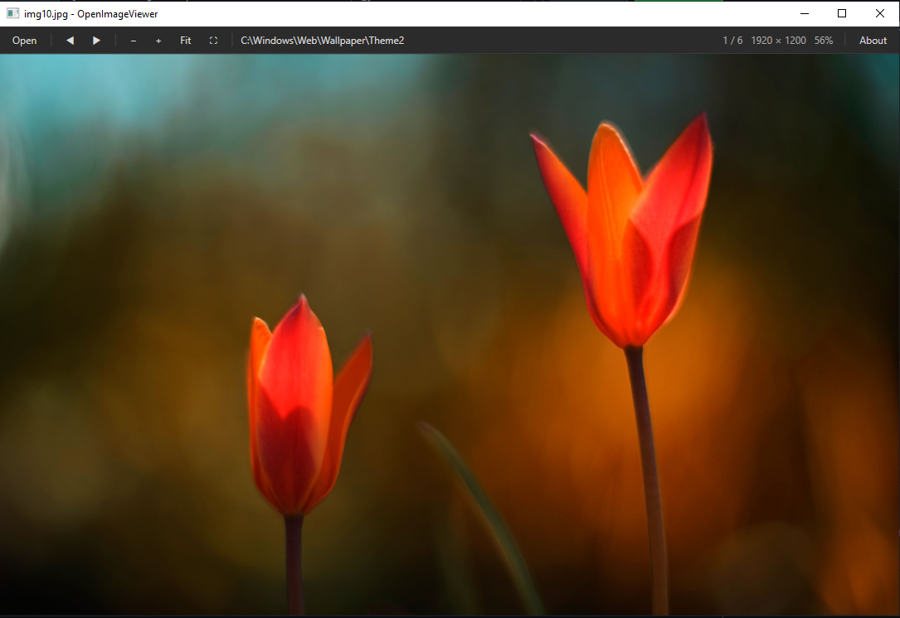

# OpenImageViewer for Windows

**A simple, minimalist image viewer for Windows.**

[](LICENSE)
[](#requirements)

It shows one image at a time and stays out of the way. There's one dark toolbar along
the top and nothing else: no sidebars, no thumbnail strip, no library to import into,
no account and no ads. You open an image and step through the folder it's in.



*One toolbar: open, previous/next, zoom, fit, full screen, then the folder path,
the image's position in the folder, its size, the zoom level, and About.*

## Why this exists

Viewing a folder of pictures shouldn't need a photo-management suite, a
subscription or a sign-in. OpenImageViewer covers the basics: open, step
through, zoom and pan.

## Requirements

- 64-bit Windows 10 or 11
- Nothing else for the prebuilt executable. Building from source needs the
  [.NET 8 SDK](https://dotnet.microsoft.com/download/dotnet/8.0).

## Install

### Prebuilt executable

Download from the
[latest release](https://github.com/riazhassan-za/openimageviewer/releases):

`OpenImageViewer-x64.exe` is a single file with the .NET runtime bundled, for
64-bit Windows 10 or Windows 11. There's nothing to install. You can check your
download against `SHA256SUMS.txt` on the release page.

**Windows SmartScreen will warn you on first run.** The executable isn't
code-signed, because a signing certificate costs money every year and this
project is free. A new, unsigned download gets the "Windows protected your PC"
screen until enough people have run it. To run it anyway, click **More info**,
then **Run anyway**. If you'd rather not trust the download, check its SHA-256
hash first, or build it yourself from source (below).

To check the hash in PowerShell:

```powershell
Get-FileHash .\OpenImageViewer-x64.exe -Algorithm SHA256
```

It should match the hash in `SHA256SUMS.txt`.

### From source

```powershell
git clone https://github.com/riazhassan-za/openimageviewer.git
cd openimageviewer
dotnet build -c Release
```

The executable is in `bin\Release\net8.0-windows\OpenImageViewer.exe`.

## Run

```powershell
dotnet run -- "C:\path\to\image.jpg"   # the path is optional
```

You can also pass an image path to `OpenImageViewer.exe` directly. That means you can
choose it from **Open with…** in Explorer, or drag an image onto the exe.

## Controls

| Action | How |
| --- | --- |
| Next image | **→**, **↓**, **Space**, **Page Down** or **▶** |
| Previous image | **←**, **↑**, **Backspace**, **Page Up** or **◀** |
| First / last image | **Home** / **End** |
| Zoom in / out | Mouse **scroll wheel** (zooms around the cursor), the **+** / **−** buttons, or the keys **+** or **=** / **-** or **_** (Shift optional, numpad works too) |
| Scroll through images | Turn on **mouse wheel lock** with **M**, a **right-click** on the image, or the mouse icon. Scroll up then goes to the previous image and scroll down to the next |
| Pan | **Left-click and drag** while zoomed in |
| Fit to window | **F** or **Fit** |
| Copy image to clipboard | **C** (or **Ctrl+C**), or the copy icon |
| Full screen | **F11** or **⛶**. **Esc** exits |
| Open a file | **Open**, **Ctrl+O**, click the folder path in the toolbar, or drag and drop a file onto the window |

Next and previous step through the images in the current folder in
alphabetical order, wrapping around at the ends.

Images larger than the window are shrunk to fit. Smaller ones are shown at their
real pixel size, not stretched up. The toolbar shows the folder, the image's
position in the folder, its dimensions and the current zoom level. The file name
is in the window title.

## Supported formats

JPEG, PNG, BMP, GIF, TIFF and ICO always work. WebP and HEIC work if the matching
Windows codec is installed (the *WebP Image Extensions* and *HEIF Image
Extensions* from the Microsoft Store). Decoding is done by Windows itself, so
there are no third-party image libraries.

## Layout

| File | Purpose |
| --- | --- |
| `App.xaml(.cs)` | Startup, command-line path, shared dark toolbar styles |
| `MainWindow.xaml(.cs)` | Toolbar, viewport, zoom/pan, folder navigation, full screen |
| `AboutWindow.xaml(.cs)` | About box and donation address |

## Donate

Tired of being ripped off for basic software that should be free? Send
donations to help fund ad-free/subs-free software for great justice.

Send Bitcoin:

[`bc1qrelrzwd4rm6uxdjk9kkzynzl4ggtnl2c5f2k7f`](bitcoin:bc1qrelrzwd4rm6uxdjk9kkzynzl4ggtnl2c5f2k7f)

The same address is in the **About** box in the viewer. There's no paid tier,
no telemetry and nothing held back. The viewer makes no network connections of
its own. The only time it goes online is when you click a link in the About box.

## License

GPL-3.0-or-later. See [LICENSE](LICENSE).
